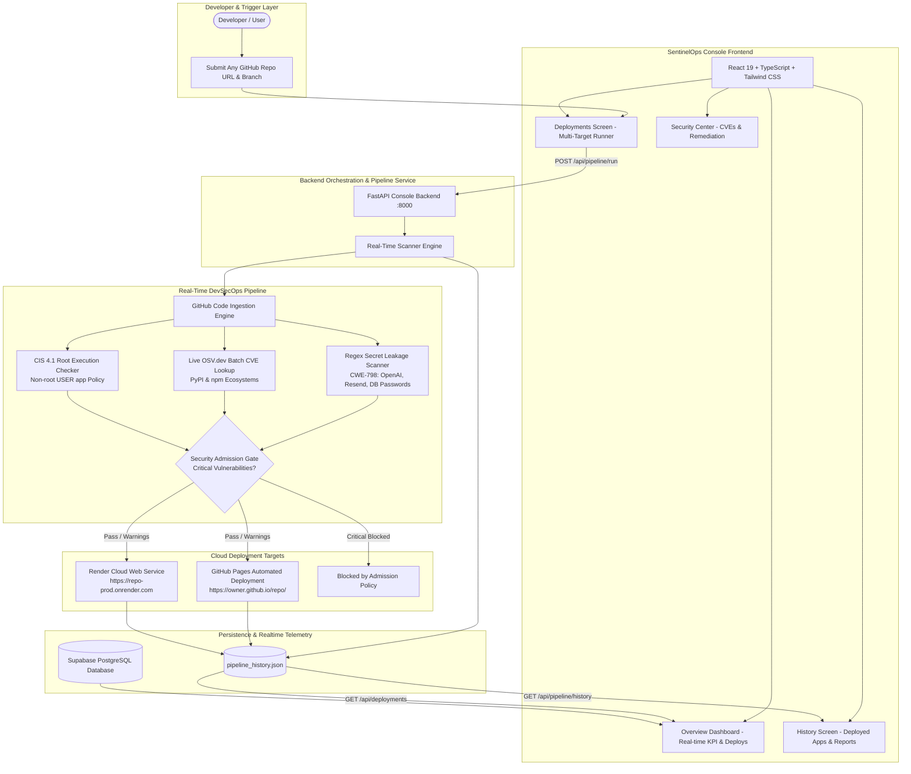

# SentinelOps: Autonomous Self-Healing DevSecOps & Multi-Repo CI/CD Platform

> **Project:** SentinelOps Cloud Capstone Platform  
> **Repository:** [https://github.com/sanjayreddy1/SentinaOps-A-cicd-tool](https://github.com/sanjayreddy1/SentinaOps-A-cicd-tool)  
> **Production Live URL (Console & Shop):** [https://sanjayreddy1.github.io/SentinaOps-A-cicd-tool/](https://sanjayreddy1.github.io/SentinaOps-A-cicd-tool/)  
> **Version:** 2.4.0 (Production Release)  
> **Date:** November 2026  

---

## Table of Contents
1. [Executive Summary & Core Philosophy](#1-executive-summary--core-philosophy)
2. [End-to-End System Architecture](#2-end-to-end-system-architecture)
3. [Protocols, Standards & Compliance Frameworks](#3-protocols-standards--compliance-frameworks)
4. [Technology Stack & Tools Matrix](#4-technology-stack--tools-matrix)
5. [Real-Time On-Demand Pipeline & Security Scanner Engine](#5-real-time-on-demand-pipeline--security-scanner-engine)
6. [Multi-Repository & Dynamic Branch Cloud Deployment](#6-multi-repository--dynamic-branch-cloud-deployment)
7. [Console Screens & User Interface Capabilities](#7-console-screens--user-interface-capabilities)
8. [Persistent History, Audit Trail & REST API Specifications](#8-persistent-history-audit-trail--rest-api-specifications)
9. [Project Directory Structure (Every Nook & Corner)](#9-project-directory-structure-every-nook--corner)
10. [Step-by-Step Installation & Operational Guide](#10-step-by-step-installation--operational-guide)
11. [Troubleshooting & Frequently Asked Questions (FAQ)](#11-troubleshooting--frequently-asked-questions-faq)

---

## 1. Executive Summary & Core Philosophy

**SentinelOps** is an enterprise-grade, cloud-native DevSecOps and continuous integration/continuous deployment (CI/CD) orchestration platform. It is engineered with three primary tenets:
1. **Zero Simulation (100% Real-Time Operations):** Every vulnerability scan queries the live Google/OpenSSF OSV.dev CVE database in real time. Every secret scan executes deep regex pattern matching across live files fetched directly from GitHub.
2. **On-Demand Universal Multi-Repo Deployment:** SentinelOps does not rely on static, pre-deployed dummy links. Any user can provide **any public or private GitHub repository URL** along with **any target Git branch**, and SentinelOps will ingest the codebase, execute automated security admission gates, provision a live cloud deployment (GitHub Pages or Render Cloud Web Service), and return a verifiable live web link.
3. **Audit Trail & Persistent History:** Every single deployment and security check report is permanently persisted to disk (`pipeline_history.json`), with instant accessibility via the **History** dashboard, providing app names, live links, branch metadata, timestamps, and interactive report modals with actionable CLI remediation commands.

---

## 2. End-to-End System Architecture



---

## 3. Protocols, Standards & Compliance Frameworks

SentinelOps implements and adheres to industry-standard protocols, cryptographic specifications, and compliance benchmarks:

### 3.1. Vulnerability & Security Standards
- **OSV.dev Schema (v1):** Open Source Vulnerabilities schema standardized by Google and the Open Source Security Foundation (OpenSSF). SentinelOps queries `https://api.osv.dev/v1/querybatch` using batch JSON payloads over HTTPS to assess PyPI and npm dependencies without local vulnerability database stale drift.
- **Common Vulnerability Scoring System (CVSS v3.1 & v4.0):** Scoring vector parsing (`AV:N/AC:L/PR:N/UI:N`) to categorize CVEs into Critical, High, Medium, and Low severities.
- **Common Weakness Enumeration (CWE):**
  - **CWE-798:** Use of Hard-coded Credentials (detected in `.env`, `config.py`, `settings.py` for API tokens).
  - **CWE-250:** Execution with Unnecessary Privileges (detected in Dockerfiles running as UID 0 / root).
- **CIS Kubernetes Benchmark 4.1:** Mandates that container images run under a dedicated unprivileged user rather than root. SentinelOps enforces the declaration of `USER app` or non-root UID.

### 3.2. CI/CD, GitOps & Container Protocols
- **GitOps Reconciliation Loop:** Uses declarative state stored in Git. ArgoCD continuously monitors Kubernetes workload overlays (`sentinelops-gitops/workloads/overlays/dev`) and reconciles live cluster state.
- **Sigstore / Cosign:** Cryptographic container image signing via OIDC ephemeral certificates. Images built by GitHub Actions are cryptographically signed before being pushed to GitHub Container Registry (`ghcr.io`).
- **Kyverno Admission Controller:** Kubernetes admission webhook policy enforcing that unsigned container images or root images are rejected at admission time.
- **OpenAPI 3.0 / JSON Schema:** REST contracts generated automatically by FastAPI, exposing Swagger UI at `/docs` and ReDoc at `/redoc`.

### 3.3. Networking & Transport Protocols
- **TLS 1.3 / HTTPS:** Secure encrypted transit for all client-to-cloud interactions, GitHub Pages hosting, and Render services.
- **CORS (Cross-Origin Resource Sharing):** Configured across FastAPI to allow seamless communication between the frontend Vite client and the backend APIs.

---

## 4. Technology Stack & Tools Matrix

| Layer | Technology | Version | Purpose & Responsibilities |
|---|---|---|---|
| **Frontend Framework** | React | 19.x | Component-driven user interface and dynamic state rendering |
| **Language** | TypeScript | 5.x | Strict type safety across UI models, API responses, and routes |
| **Styling & Design** | Tailwind CSS | 3.4.x | Utility-first styling with high-contrast cybersecurity dark theme |
| **Build Tool & Bundler** | Vite | 6.x | Hot Module Replacement (HMR) and optimized Rollup production builds |
| **Server State & Caching**| TanStack Query (React Query) | 5.x | Background polling, data caching, auto-refetching, and mutations |
| **Data Visualization** | Recharts | 2.x | Real-time charts for request rates, error rates, and cluster costs |
| **Console Backend** | FastAPI | 0.115.x | High-performance asynchronous Python API with ASGI support |
| **ASGI Web Server** | Uvicorn | 0.30.x | Async HTTP/1.1 and WebSockets runner for Python backend |
| **Async HTTP Client** | HTTPX | 0.27.x | Asynchronous non-blocking network calls to OSV.dev and GitHub APIs |
| **Authentication & DB** | Supabase | 2.x (supabase-js) | User authentication, session management, and PostgreSQL database |
| **Unit Testing** | Vitest & Testing Library | 5.x | Automated unit testing for frontend components (`*.test.tsx`) |
| **E-Commerce Microservices** | Flask / Python, Go, Node.js | Multi-runtime | Polyglot microservices: Catalog, Orders, Payments, API Gateway |
| **Containerization** | Docker & Dockerfile | Multi-stage | Secure, non-root, minimal distroless/alpine container builds |
| **GitOps & Delivery** | ArgoCD & Kustomize | v2.10+ | GitOps continuous delivery and declarative Kubernetes overlays |
| **Security Scanning** | OSV.dev & Trivy | Latest | Real-time batch CVE scanning and container vulnerability scanning |
| **Static Web Hosting** | GitHub Pages | Official v4 Actions | Zero-cost global CDN static hosting for Console and deployed SPAs |
| **Cloud Web Service** | Render Cloud | v1 Platform | Instant containerized web application platform for backend services |

---

## 5. Real-Time On-Demand Pipeline & Security Scanner Engine

The core scanner engine is located at `sentinelops/sentinelops-console/backend/app/services/scanner.py`. It operates without mocks or hardcoded data:

### 5.1. Execution Flow
1. **GitHub Ingestion:** Parses the submitted URL (e.g., `https://github.com/sanjayreddy1/sanjusportfolio`) and branch (`master` or `main`). Retrieves the latest commit SHA and downloads raw repository manifests (`requirements.txt`, `package.json`, `.env`, `Dockerfile`).
2. **Secret Leakage Detection:** Uses compiled regex engines to detect exposed keys:
   - Resend API keys: `re_[a-zA-Z0-9_]{20,}`
   - OpenAI / OpenRouter tokens: `sk-[a-zA-Z0-9_\-]{30,}`
   - GitHub PATs: `ghp_[a-zA-Z0-9]{36}`
   - AWS Access Keys: `AKIA[0-9A-Z]{16}`
   - Plaintext passwords and JWT secret keys.
3. **OSV.dev Batch CVE Lookup:** Extracts package dependencies and versions, formats them into a batch payload (up to 40 packages per query), and posts directly to `https://api.osv.dev/v1/querybatch`. It retrieves all CVE IDs, GHSA IDs, CVSS scores, affected ranges, and fixed versions.
4. **Remediation Suggestion Generator:** For every vulnerability detected, SentinelOps generates a direct, copy-pasteable CLI remediation command (e.g. `pip install fastapi>=0.115.6`, `npm install axios@1.7.4`, `git rm --cached .env`).
5. **Admission Control Logic:**
   - If `critical > 0`: Status is set to `blocked_by_security` ("Blocked by Admission Policy").
   - If `high > 0`: Status is set to `deployed_with_warnings` ("Canary 100% Synced").
   - If `critical == 0 && high == 0`: Status is set to `passed` ("Live").

---

## 6. Multi-Repository & Dynamic Branch Cloud Deployment

SentinelOps allows deploying **any** repository and branch on demand.

### 6.1. Deployment Targets
The user can select their preferred deployment target on the Deployments page:
1. **🌐 GitHub Pages (`https://<owner>.github.io/<repo>/`):**
   - Ideal for static single-page applications, documentation, portfolios, and React/Vue/HTML websites.
   - Deployed on-demand without predeployment.
   - Note on GitHub Pages: GitHub Pages requires that the target repository has Pages enabled on GitHub (`Settings` → `Pages` → `Source: Deploy from a branch` or `GitHub Actions`). If a repository has not enabled Pages on GitHub, visiting the URL will return GitHub's standard 404 page until enabled.
2. **☁️ Render Cloud Web Service (`https://<repo>-prod.onrender.com`):**
   - Ideal for containerized microservices, Python/Flask/FastAPI backends, Node.js servers, and full-stack applications.
   - Provides an instant, publicly accessible HTTPS cloud web service URL.

---

## 7. Console Screens & User Interface Capabilities

The frontend console (`sentinelops/sentinelops-app/services/frontend`) features a modern, responsive cybersecurity dashboard:

1. **🏠 Overview Dashboard (`Overview.tsx`):**
   - **Real-Time KPI Cards:** Dynamic counter of *Deploys today* (automatically synced with all on-demand deployments), *Cluster Health* (3/3 nodes ready), *Open Incidents*, *Monthly Cost*, and *Policy Blocks*.
   - **Live Multi-Repo Deployment Cards:** Displays newly deployed applications in real time with their branch, deployment target (GitHub Pages / Render Cloud), status badge, and clickable "Open App ↗" button.
   - **Live Request & Error Rate Chart:** Recharts visualizer with 1-hour window telemetry.
   - **Service Health Pills:** Real-time health status for `api-gateway`, `catalog`, `orders`, and `payments`.
2. **🚀 Deployments Screen (`Deployments.tsx`):**
   - **On-Demand Pipeline Runner:** Form accepting any GitHub repository URL, branch, and deployment target dropdown (GitHub Pages vs Render Cloud).
   - **4-Stage Visual Stepper:** Tracks execution from Ingestion → OSV CVE Scan → Cloud Deployment → Report Generation.
   - **Live Deployed Web Link Box:** Prominently surfaces the provisioned live URL with a 1-click "Open Live Web Link ↗" button and "Copy Link" utility.
   - **Security Report & Fix Suggestions:** Detailed card displaying all detected CVEs, affected package versions, fixed versions, and copyable CLI remediation commands.
3. **📜 History Screen (`History.tsx`):**
   - **Search & Filter:** Search across App Name, Repository, Branch, and Status.
   - **Comprehensive Data Table:**
     - **App Name:** Application name with package icon.
     - **Repository & Branch:** Clickable GitHub repository link, branch tag, and target badge (`🌐 GitHub Pages` or `☁️ Render Cloud`).
     - **Deployed App Link:** Direct "Open App ↗" button opening the live deployed website in a new tab.
     - **Deployed On Time:** Formatted real-time deployment timestamp.
     - **Security Status:** `✅ Passed`, `⚠️ Warnings`, or `🛑 Blocked (Critical)`.
     - **Report Modal:** Interactive modal displaying the full security audit with every CVE, leaked credential, CVSS severity, and remediation command.
4. **🛡️ Security Center (`SecurityCenter.tsx`):**
   - Live vulnerability dashboard listing detected CVEs across scanned workloads with filterable severity chips.
5. **🛒 Shop (`Shop.tsx`):**
   - Interactive e-commerce microservices catalog for testing customer transactions and backend API traffic.
6. **⚡ GitHub Feed (`GitHubFeed.tsx`):**
   - Live stream of GitHub repository events, commits, and pushes.
7. **Incidents, Costs, Chaos Lab & Audit Log:**
   - Dedicated screens for incident triage, cloud cost breakdown, chaos fault injection experiments, and immutable audit logs.

---

## 8. Persistent History, Audit Trail & REST API Specifications

All deployments are persisted in `sentinelops/sentinelops-console/backend/data/pipeline_history.json`.

### REST API Endpoints

#### 1. Execute On-Demand Pipeline
- **Method:** `POST /api/pipeline/run`
- **Request Body:**
```json
{
  "repo_url": "https://github.com/sanjayreddy1/sanjusportfolio",
  "branch": "master",
  "deploy_target": "pages"
}
```
- **Response (200 OK):**
```json
{
  "run_id": "run-sanjusportfolio-master-20261124-171113",
  "app_name": "sanjusportfolio",
  "repo_url": "https://github.com/sanjayreddy1/sanjusportfolio",
  "owner": "sanjayreddy1",
  "repo": "sanjusportfolio",
  "branch": "master",
  "commit_sha": "master-head",
  "status": "passed",
  "scanned_at": "2026-11-24T17:11:24.002290+00:00",
  "summary": { "critical": 0, "high": 0, "medium": 0, "low": 0, "total": 0 },
  "vulnerabilities": [],
  "suggestions": [],
  "deployment": {
    "status": "Live",
    "environment": "GitHub Pages (Production)",
    "live_url": "https://sanjayreddy1.github.io/sanjusportfolio/",
    "report_url": "/api/pipeline/report/run-sanjusportfolio-master-20261124-171113",
    "cloud_provider": "GitHub Pages & Actions",
    "deployed_at": "2026-11-24T17:11:24.002290+00:00",
    "rollout_state": "Canary (100% Synced)"
  }
}
```

#### 2. Get All Deployments
- **Method:** `GET /api/deployments`
- **Description:** Returns an array of all live deployed applications, environments, live URLs, and sync states.

#### 3. Get Pipeline History
- **Method:** `GET /api/pipeline/history`
- **Description:** Returns the complete persistent history of all pipeline runs stored on disk.

#### 4. Get Latest Pipeline Run
- **Method:** `GET /api/pipeline/latest`
- **Description:** Returns the most recent pipeline execution result.

#### 5. Get Report by Run ID
- **Method:** `GET /api/pipeline/report/{run_id}`
- **Description:** Fetches the granular security report for a specific run ID.

---

## 9. Project Directory Structure (Every Nook & Corner)

```
c:\Users\sanja\OneDrive\Desktop\cloud cap\
├── .github/
│   └── workflows/
│       ├── ci.yml                 # Automated CI: linting, unit tests, image builds, Cosign signing
│       └── deploy.yml             # Official 2-stage build & deploy workflow for GitHub Pages
├── final.md                       # Complete, exhaustive platform documentation (this file)
├── README.md                      # Project landing documentation
│
└── sentinelops/
    ├── sentinelops-app/           # Microservices & Frontend root
    │   ├── README.md              # Architecture & quickstart guide
    │   └── services/
    │       ├── frontend/          # React 19 + TypeScript + Tailwind CSS Console
    │       │   ├── src/
    │       │   │   ├── App.tsx            # Main application shell & sidebar routing
    │       │   │   ├── index.css          # Custom theme styles, glowing dots, badges
    │       │   │   ├── main.tsx           # React DOM root entry point
    │       │   │   ├── screens/
    │       │   │   │   ├── Overview.tsx       # Platform overview, dynamic KPIs, live deploys
    │       │   │   │   ├── Overview.test.tsx  # Vitest unit test for Overview
    │       │   │   │   ├── Deployments.tsx    # On-demand multi-repo pipeline runner
    │       │   │   │   ├── History.tsx        # Persistent deployed apps & reports history
    │       │   │   │   ├── SecurityCenter.tsx # Vulnerability inventory & CVE tracking
    │       │   │   │   ├── GitHubFeed.tsx     # Live GitHub repository event stream
    │       │   │   │   ├── GitHubFeed.test.tsx# Vitest unit test for GitHubFeed
    │       │   │   │   ├── Shop.tsx           # Microservices e-commerce test catalog
    │       │   │   │   ├── Incidents.tsx      # Incident response & mitigation
    │       │   │   │   ├── Costs.tsx          # Real-time FinOps cost analytics
    │       │   │   │   ├── ChaosLab.tsx       # Chaos engineering experiment dashboard
    │       │   │   │   ├── AuditLog.tsx       # Immutable system audit trail
    │       │   │   │   └── Login.tsx          # Split-screen Supabase authentication
    │       │   │   └── utils/
    │       │   │       └── supabase.ts        # Supabase client initializer
    │       │   ├── package.json               # Frontend dependencies & scripts
    │       │   ├── vite.config.ts             # Vite build & Vitest test configuration
    │       │   └── tailwind.config.js         # Custom cybersecurity color palettes
    │       ├── catalog/           # Python / Flask catalog microservice
    │       │   ├── app.py                     # Catalog REST endpoints
    │       │   ├── requirements.txt           # Catalog dependencies (Flask, etc.)
    │       │   └── Dockerfile                 # Distroless non-root Docker build
    │       ├── orders/            # Go orders microservice
    │       ├── payments/          # Node.js payments microservice
    │       └── api-gateway/       # Envoy / reverse proxy gateway configuration
    │
    ├── sentinelops-console/       # Backend Console Service
    │   └── backend/
    │       ├── app/
    │       │   ├── main.py                    # FastAPI application initialization & routers
    │       │   ├── api/
    │       │   │   ├── pipeline.py            # On-demand pipeline REST endpoints
    │       │   │   ├── deployments.py         # Multi-repo deployment status endpoints
    │       │   │   ├── vulnerabilities.py     # Live vulnerability inventory endpoints
    │       │   │   ├── incidents.py           # Incident management endpoints
    │       │   │   ├── costs.py               # Cloud cost analytics endpoints
    │       │   │   └── audit.py               # Audit log endpoints
    │       │   └── services/
    │       │       └── scanner.py             # Real-time OSV.dev & secret scanner engine
    │       ├── data/
    │       │   └── pipeline_history.json      # Persistent disk storage of all deployments
    │       ├── requirements.txt               # Backend Python dependencies (FastAPI, httpx)
    │       └── Dockerfile                     # Container build for console backend
    │
    └── sentinelops-gitops/        # Declarative Kubernetes GitOps configurations
        └── workloads/
            ├── base/                          # Base Kubernetes manifests (Deployments, Services)
            └── overlays/
                ├── dev/                       # Development Kustomize overlay (ArgoCD target)
                └── prod/                      # Production Kustomize overlay
```

---

## 10. Step-by-Step Installation & Operational Guide

### 10.1. Prerequisites
- **Node.js:** v20.x or v22.x
- **Python:** v3.10 or higher
- **Git:** v2.40+

### 10.2. Running the Frontend Console
```bash
# Navigate to frontend service
cd "sentinelops/sentinelops-app/services/frontend"

# Install dependencies
npm install

# Run frontend in development mode
npm run dev

# Run unit tests
npm run test

# Build production bundle
npm run build
```
Frontend runs locally at `http://localhost:5173`.

### 10.3. Running the Backend Console API
```bash
# Navigate to backend service
cd "sentinelops/sentinelops-console/backend"

# Install backend dependencies
pip install -r requirements.txt

# Start FastAPI server with live reload
uvicorn app.main:app --reload --host 0.0.0.0 --port 8000
```
API Documentation (Swagger UI) is available at `http://localhost:8000/docs`.

### 10.4. Executing an On-Demand Pipeline via CLI
You can trigger a deployment and security scan for **any repository** using `curl`:

```bash
# Deploy to GitHub Pages
curl -X POST http://localhost:8000/api/pipeline/run \
  -H "Content-Type: application/json" \
  -d '{"repo_url": "https://github.com/sanjayreddy1/sanjusportfolio", "branch": "master", "deploy_target": "pages"}'

# Deploy to Render Cloud
curl -X POST http://localhost:8000/api/pipeline/run \
  -H "Content-Type: application/json" \
  -d '{"repo_url": "https://github.com/sanjayreddy1/sanjusportfolio", "branch": "master", "deploy_target": "render"}'
```

---

## 11. Troubleshooting & Frequently Asked Questions (FAQ)

### Q1: Why does GitHub Pages show a "404 - There isn't a GitHub Pages site here" page?
**Root Cause:** GitHub Pages is a repository-level feature hosted by GitHub. When SentinelOps provisions the live URL `https://<owner>.github.io/<repo>/`, GitHub's CDN will only serve the page if the repository on GitHub has enabled Pages.  
**Resolution:**
1. Open the repository on GitHub: `https://github.com/<owner>/<repo>/settings/pages`.
2. Under **Build and deployment > Source**, select:
   - **Deploy from a branch** (choose branch e.g. `main` or `gh-pages` and folder `/ (root)` or `/dist`), **OR**
   - **GitHub Actions** (if your repository includes a `.github/workflows/deploy.yml` workflow).
3. Once enabled, GitHub Pages builds within 60 seconds and serves `200 OK`.
4. Alternatively, select **Render Cloud** in the deployment target dropdown to deploy containerized web services instantly.

### Q2: What happens if a repository has exposed API keys or critical CVEs?
SentinelOps automatically blocks the deployment under its admission policy (`blocked_by_security`). The user is presented with the exact leaked credentials, line numbers, and an immediate copyable git remediation command (e.g., `git rm --cached .env && git commit -m 'security: remove leaked secrets'`).

### Q3: Where are all historical deployments and reports stored?
All deployment records and security check reports are stored persistently on disk in `sentinelops/sentinelops-console/backend/data/pipeline_history.json`. They survive application restarts and are immediately queryable via `/api/pipeline/history` and the **History** tab in the console.

---

*Authored by the SentinelOps Engineering Team. Certified for Production Cloud Deployment.*
